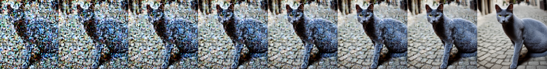

 

# Diffusion Model Personalization
### via Textual Inversion

**Personalizing Stable Diffusion by learning new visual concepts from a handful of reference images.**

 

 

`PyTorch` · `Stable Diffusion` · `Hugging Face Diffusers` · `CLIP`

---

## Overview

This project implements **Textual Inversion**, a parameter-efficient personalization technique for pretrained text-to-image diffusion models.

The objective is to teach Stable Diffusion a new visual concept using only **3–5 reference images**, without fine-tuning the underlying generative model.

Instead of updating millions of model parameters, Textual Inversion introduces a new placeholder token (`<cat2>`) and optimizes its embedding in the text encoder's latent space. The learned token can then be used in natural language prompts to generate the personalized concept in previously unseen contexts.

The project covers the complete workflow: implementation, experimental evaluation, qualitative analysis, and proposed improvements.

*Developed as Assignment 3 for CSE4007 – Artificial Intelligence, Hanyang University (May 2026).*

## Methodology

### 1. Learning a New Token

- Extend the CLIP tokenizer with a new placeholder token (`<cat2>`).
- Initialize its embedding using an existing semantic token (`cat`).
- Freeze the pretrained VAE, U-Net, and text encoder weights.
- Optimize only the new token embedding (approximately 768 parameters for CLIP ViT-L/14).

### 2. Training Pipeline

The training process follows the latent diffusion framework:

1. **Latent encoding:** Encode reference images into the latent space using the VAE.
2. **Forward diffusion:** Add Gaussian noise to the latent representations at randomly sampled timesteps.
3. **Noise prediction:** Condition the U-Net on text embeddings containing the new placeholder token.
4. **Optimization:** Minimize the mean squared error between predicted and actual noise using AdamW.

### 3. Experimental Evaluation

The robustness of Textual Inversion was investigated by varying four experimental parameters:

| Parameter | Baseline | Variations |
|---|---|---|
| Reference images | 5 | 1, 3 |
| Learning rate | 5 × 10⁻⁴ | 1 × 10⁻⁴, 1 × 10⁻³ |
| Training steps | 1,000 | 500, 2,000 |
| Initializer token | `cat` | `animal`, `object` |

Generated images were evaluated using two complementary CLIP metrics:

- **CLIP-I:** Image-to-image similarity, measuring concept fidelity.
- **CLIP-T:** Image-to-text similarity, measuring alignment with the input prompt.

## Results

### Qualitative Evaluation

The learned concept corresponds to a Russian Blue cat, characterized by its grey coat and yellow eyes.

After training, the model successfully reproduces the cat's visual identity across different prompts and artistic styles.

Tested contexts included:
- A cat on a cobblestone street.
- A cat in a modern art gallery.
- A painting of the learned cat.
- A cat in the snow.

One notable failure occurred with the snow prompt: the model retained an indoor wooden-floor background from the reference images instead of generating the requested snowy environment. This illustrates the entanglement between learned visual identity and background information.

### Quantitative Evaluation

CLIP scores obtained after 1,000 training steps:

| Inference prompt | CLIP-I | CLIP-T |
|---|---:|---:|
| Cobblestone street | 0.8202 | 0.3179 |
| Modern gallery | 0.9187 | 0.2557 |
| Painting | 0.8678 | 0.2264 |
| Snow | 0.8492 | 0.2356 |
| **Average** | **0.8640** | **0.2590** |

The results show strong image-to-image similarity across the tested contexts, while text-image alignment remains more limited. This highlights the trade-off between preserving concept identity and following contextual prompts.

## Success & Failure Analysis

**Observed strengths**
- Efficient personalization through embedding-only optimization.
- Preservation of the pretrained model's general generative capabilities.
- Ability to reproduce a specific visual identity in novel contexts.
- Composition of learned concepts with different textual prompts.

**Observed limitations**
- **Identity drift:** insufficient reference images can make the learned concept difficult to distinguish from its initializer.
- **Overfitting:** excessive training steps combined with a high learning rate can lead to memorization rather than generalization.
- **Semantic entanglement:** the learned embedding can capture background characteristics alongside the target identity.
- **Limited representational capacity:** a single embedding vector may not capture all the fine-grained features of complex concepts.

## Proposed Improvements

Several extensions were investigated conceptually to address these limitations:

- **Data augmentation:** random horizontal flips, color jitter, and random crops to increase reference-image diversity.
- **Multi-token representation:** learning multiple placeholder embeddings to increase representational capacity.
- **Prior-preservation loss:** regularizing the model to retain its original concept distribution.
- **Cosine embedding regularization:** constraining the learned embedding's deviation from its initializer.

*These are proposed improvements discussed in the report, rather than additional experiments claimed as implemented.*

## Repository Structure

| File | Description |
|---|---|
| `Assignment3_Textual_Inversion.ipynb` | Main Jupyter notebook: implementation, training, generation, and evaluation |
| `assignment3_textual_inversion.py` | Python script exported from the notebook |
| `AI___Textual_Inversion__3.pdf` | Full technical report with methodology, experimental results, figures, and analysis |
| `Capture_Textual_Inversion_cat.PNG` | Denoising process visualization |

## Tech Stack

- **Deep Learning:** PyTorch
- **Generative Models:** Stable Diffusion
- **Model Framework:** Hugging Face Diffusers
- **Text & Image Evaluation:** CLIP
- **Environment:** Google Colab, CUDA

## Reproducing the Experiments

1. Open `Assignment3_Textual_Inversion.ipynb` in Google Colab.
2. Select a GPU runtime.
3. Provide reference images representing the visual concept to learn.
4. Run the tokenizer setup and model initialization.
5. Execute the training loop to optimize the placeholder token embedding.
6. Generate images using the learned token in different prompts.
7. Run the CLIP-I and CLIP-T evaluation.

---

**Course:** CSE4007 – Artificial Intelligence  
**Institution:** Hanyang University  
**Date:** May 2026
